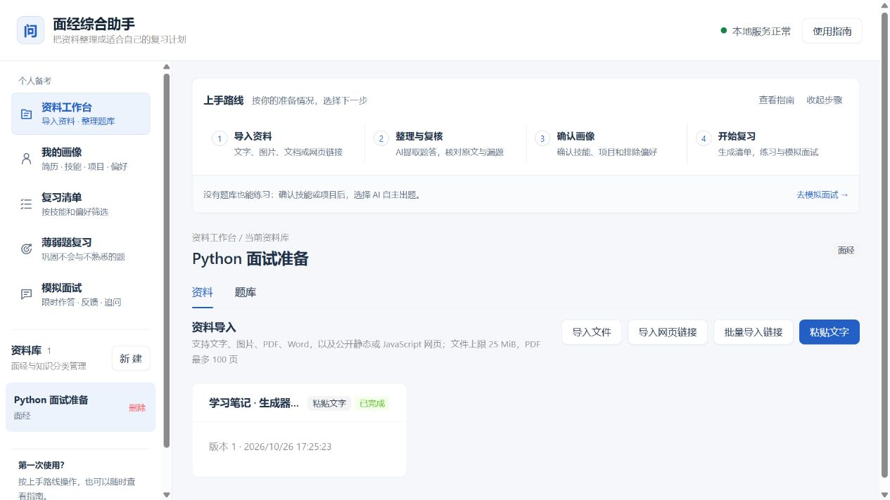

# 面经综合助手

把分散的面经和内部八股知识整理成可检索、可修订的个人问答库。系统组成和数据流见[项目目录与架构](./docs/项目目录与架构.md)。

第一次使用：先按[启动步骤](./启动步骤.md)运行，再查看[使用手册](./使用手册.md)。应用内可随时打开“使用指南”。有资料时从导入和题答复核开始；没有题库时可先确认画像，直接使用AI自主模拟面试。



## 功能概览

- 创建面经或知识库资料库。
- 粘贴纯文字/Markdown，或导入 UTF-8 编码的 `.txt`、`.md`、`.markdown` 文件；单份上限 1 MiB。
- 查看原文、修订并保留历史版本和文本块定位。
- 手动建题，或从资料段落建题；答案可以暂时为空。
- 编辑题目和答案，保存或删除私人备注，按题干与答案关键词检索。
- 问题、答案、代码使用不同字体；Markdown 不执行原始 HTML，也不自动加载远程图片。
- 本机固定用户隔离、创建请求幂等、并发编辑版本冲突检查和刷新后持久化。
- 上传 `.png`、`.jpg`、`.jpeg` 图片，上限 10 MiB；上传 `.pdf`、`.docx`、`.doc` 文档，上限 25 MiB，PDF 最多 100 页。
- 通过同一个链接入口导入公开网页：先提取静态正文，遇到 JavaScript 空壳时自动使用隔离的 Chromium 渲染，再保存来源 URL、抓取时间与 HTML 快照。
- 一次粘贴最多 50 个网页链接，支持批内去重、同库复用、逐条状态与重试、刷新后历史；保留 hash 章节地址。
- Celery Worker 后台解析，界面自动刷新等待、处理、部分完成、等待配置和失败状态，并支持最多三次手动重试。
- 图片、扫描 PDF 和 DOCX 内嵌图片可通过智谱 `glm-ocr` 或 DeepSeek `deepseek-flash` 识别，由 `OCR_PROVIDER` 独立选择；未配置 Key 时保留资料并明确提示。
- PDF 文字层、DOCX 段落/标题/表格及旧 `.doc` 转换可在本地完成；旧 `.doc` 由容器内无界面的 LibreOffice 转换。
- 网页导入拒绝本机、私网、保留地址和非标准端口；静态请求与浏览器请求都会检查目标地址，并限制请求数、响应大小和超时。
- 链接导入只处理匿名可访问的单个页面；需要登录、验证码或当前章节没有体现在 URL 中时，界面会提示改用粘贴文字或上传文件。
- 使用 GLM 或 DeepSeek 从当前资料版本自动整理题目；模型结果必须逐字回指原文，单批失败时会保留其他批次的有效结果。
- 自动区分有答案和无答案问题，不为缺失答案生成占位内容；支持按答案状态、复核状态和关键词筛选。
- 对照原文逐题确认、修改、拒绝或重置，并通过确定性检查列出疑似漏题，允许从准确原文范围补建。
- 在独立的“我的画像”中上传和版本化管理简历，提取带原文证据的目标岗位和技能；支持确认、排除、编辑和补充技能。
- 管理全局优先/排除偏好及其题目/答案作用范围，并支持技术目录和自定义技术项。
- 生成版本化的“我的复习清单”：题干和答案分别识别技术依赖，显示进入、排除、排序及答案不适用原因；画像、规则或题库内容变化后旧结果会提示重新生成。
- 从“我的复习清单”导出 Markdown 个人备考包：覆盖全部分页的进入清单题目、适用答案、来源快照及可选当前备注；保留历史版本提示，不生成缺失答案。
- 画像支持独立的项目提取、确认和编辑；复习清单在既有筛选之后提供项目关联建议及共有主题依据，可按项目或通用题筛选，Markdown 保留关联快照。
- 在复习清单点击“项目追问链”，选择已确认项目及最多3道已有题，生成最多3层、带项目与种子题引用的 AI 追问；结果单独保存、可追溯和导出，不生成答案或自动加入原题库。
- 首页“模拟面试”支持AI规划题目、逐题文字作答、可调时限／暂停／加时、草稿恢复、回答反馈及用户主动选择追问；不会时直接换方向并跳过同主题题，不生成参考答案。
- 在题库或复习清单标记已掌握、不熟悉、不会；“薄弱题复习”按当前技能和偏好筛选，面试不会题经用户确认后加入，AI题独立保存。
- 模拟面试可选题库／AI自主／混合出题。没有知识库时，仅确认简历技能或项目即可自主出题，并继续选择追问；显示技能/项目依据。AI规划会保留有效题并限次补缺，提供出题检查详情和开始前手动补足入口。
- 按需单题生成AI补充答案，草稿可编辑、确认采用或丢弃；AI来源持续标注，原资料/手写答案保留。已确认且适用的补充答案可进入新复习清单，并在导出等页面保留来源。
- 工作台提供清晰的功能导航、可折叠上手步骤和应用内使用指南，兼容有资料与无题库两条备考路径。
- 自动整理失败或部分成功时可安全重试，最多三次；重复请求不会重复建题，也不会覆盖已复核或人工修改内容。
- 题库和新复习清单展示去重后的面经／知识库来源、原文出处和近 180 天面经来源数；资料日期可手动核对填写，未知日期保留。
- 资料详情和原文复核页提供全量抽取质量概览，区分出现记录、去重题目、有效题目、复核状态、原文答案及疑似漏题；新任务记录批次和候选诊断，历史未知指标明确提示。
- 默认 Compose 使用构建后的前端和无热更新 API；API、Worker、Web 与渲染器使用只读根文件系统、非 root 用户、资源限制和轮转日志。
- API 响应包含请求关联 ID、禁止私有数据缓存的响应头和不记录正文的最小访问日志。
- PowerShell 脚本同时备份 PostgreSQL 与 `data/`，使用 SHA-256 清单验真，并支持恢复前自动安全备份、失败回滚和完整恢复演练。
- 隔离性能基准覆盖 5,000 道题和 20,000 个来源块；稳定模式支持全服务健康检查和重启持久化验证。

详细操作见[使用手册](./使用手册.md)，输入限制、模型调用范围和已知限制见[功能口径与限制](./docs/功能口径与限制.md)。个性化清单不会改写基础题库，你可以随时回看被排除的题目及原因。

## 技术栈

- 前端：React、TypeScript、Vite、Ant Design、TanStack Query
- 后端：FastAPI、SQLAlchemy、Alembic
- 数据：PostgreSQL（镜像包含 pgvector，当前业务以关系数据为主）
- 文档解析：pypdf、python-docx、Trafilatura、LibreOffice、Poppler（扫描 PDF 单页转图）
- 动态网页：Playwright、Chromium（独立无密钥容器）
- 图片 OCR：智谱 `glm-ocr` 或 DeepSeek `deepseek-flash`
- 后台任务：Celery、Redis

## 项目结构

```text
interview-knowledge-hub/
├── frontend/              # React + TypeScript 用户界面
├── backend/               # FastAPI、Celery、数据库模型与 Alembic 迁移
├── services/
│   └── renderer/          # 隔离的 Playwright 动态网页渲染服务
├── infra/                 # Docker Compose、环境变量模板、备份与恢复脚本
├── data/                  # 本机上传原件（Git 忽略）
├── backups/               # 本机备份（Git 忽略）
└── docs/                  # 用户功能边界与当前架构说明
```

PostgreSQL 和 Redis 由 `infra/docker-compose.yml` 启动并使用 Docker 数据卷，不在仓库中保存数据库文件。数据库表结构属于后端，因此 Alembic 迁移保留在 `backend/migrations/`。完整说明见[项目目录与架构](./docs/项目目录与架构.md)。

## 启动

前置要求：Docker 与 Docker Compose。

```bash
git clone https://github.com/zzh416/interview-knowledge-hub.git
cd interview-knowledge-hub
cp infra/.env.example infra/.env
docker compose -f infra/docker-compose.yml up -d --build
```

默认命令启动稳定运行模式。开发时需要源码热更新，可叠加开发覆盖文件：

```bash
docker compose -f infra/docker-compose.yml -f infra/docker-compose.dev.yml up -d --build
```

纯文字、文本型 PDF/Word 和网页正文的基础解析不需要模型 API Key。AI 自动整理题目和简历画像提取通过 `infra/.env` 的 `TEXT_MODEL_PROVIDER=glm|deepseek` 选择文字模型，图片识别通过 `OCR_PROVIDER=glm|deepseek` 独立选择；二者都使用所选服务商的 `GLM_API_KEY` 或 `DEEPSEEK_API_KEY`，默认 GLM，失败时不会自动切换服务商。

文字和图片都使用 DeepSeek 时，配置 `TEXT_MODEL_PROVIDER=deepseek`、`OCR_PROVIDER=deepseek`、`DEEPSEEK_API_KEY`，以及 `DEEPSEEK_OCR_MODEL=deepseek-flash`。图片转录默认输出上限为 `DEEPSEEK_OCR_MAX_OUTPUT_TOKENS=8192`；输出被截断会提示失败，不会保存为完整结果。使用 DeepSeek 时，扫描或含图 PDF 页面先在本地转为 PNG，再提交整页识别；不含图片且文字层可用的 PDF 页面、Word 原生正文仍直接在本地提取。接口依据见 [DeepSeek 官方视觉文档](https://api-docs.deepseek.com/guides/vision/)。

更新代码或依赖后，执行 `docker compose -f infra/docker-compose.yml up --build -d` 重建并启动服务。仅修改 `.env` 时，执行 `docker compose -f infra/docker-compose.yml up -d --force-recreate api worker` 使 API 和 Worker 重新读取配置。API 启动时会先执行 `alembic upgrade head`。访问地址：

- 前端：http://127.0.0.1:5173
- API 文档：http://127.0.0.1:9000/api/docs
- 存活检查：http://127.0.0.1:9000/api/v1/health/live
- 就绪检查：http://127.0.0.1:9000/api/v1/health/ready

API 和 Web 只监听宿主机的 `127.0.0.1`。停止服务不会删除数据库：

```bash
docker compose -f infra/docker-compose.yml down
```

不要使用 `down -v`，除非确实要永久删除 PostgreSQL 和 Redis 数据卷。

## 更新依赖

前端镜像使用 `package-lock.json` 和 `npm ci`。修改前端代码或依赖后重建 Web；该操作不会删除数据库卷：

```bash
docker compose -f infra/docker-compose.yml build web
docker compose -f infra/docker-compose.yml up -d --no-deps --force-recreate web
```

后端直接依赖记录在 `backend/requirements.txt`，完整解析版本固定在 `backend/requirements.lock`，镜像按锁文件安装。升级版本后重建 API 与 Worker，并运行完整测试。

## 验证

```bash
docker compose -f infra/docker-compose.yml -f infra/docker-compose.dev.yml run --rm --no-deps api python scripts/run_isolated_tests.py -q
docker compose -f infra/docker-compose.yml exec -T renderer npm test
cd frontend
npm ci
npm run test
npm run lint
npm run build
cd ..
docker compose -f infra/docker-compose.yml config --quiet
```

需要验证真实 API、任务队列或大数据量性能时，使用[启动步骤](./启动步骤.md)中的可选高级检查。

## 备份与恢复

```powershell
.\infra\backup.ps1
.\infra\verify-backup.ps1 -BackupPath .\backups\20261024-120000
.\infra\restore.ps1 -BackupPath .\backups\20261024-120000 -ConfirmRestore
```

恢复会先完整验证备份，再自动备份当前数据。备份包含 PostgreSQL 和 `data/`，不包含 `infra/.env`、API Key 或 Redis 临时任务队列。具体流程见 [启动步骤](./启动步骤.md)。

项目私有原件保存在 `data/`，环境变量保存在 `infra/.env`；两者都被 `.gitignore` 排除。
