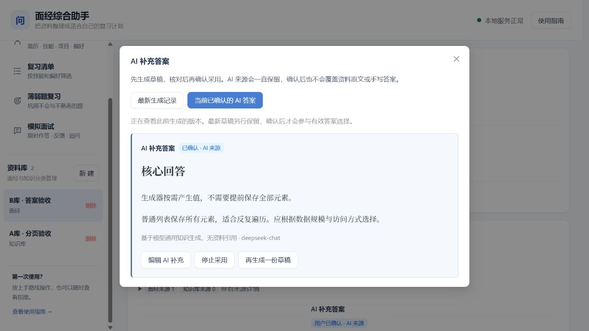

# 2026-10-26 功能完整性复查

状态：范围核对、缺陷修复、隔离回归、浏览器验证和本机服务更新均已完成。

本次以 [README](../README.md)、[使用手册](../使用手册.md)和[最新增量路线](../tasks/改进路线.md)为当前交付范围，结合 P3、P4 的历史验收记录检查实现。初始架构中的远景方案、已归档计划的旧勾选状态，不直接视为当前缺失功能。

**尚未实现的两项能力需要明确说明：**

- **跨资料库自动检索、匹配答案尚未落地。** 用户把面经上传到一个库、把内部八股答案上传到另一个库后，系统不会自动搜索后者来给前者配答案。现有来源合并、全局复习清单和 AI 补答都不等于这项能力。因此不能将“内部知识库为其他面经自动提供答案”的最初设想认定为全部完成。题目复用查询仅限当前资料库（[抽取服务](../apps/api/app/modules/question_extraction_service.py)的 `Question.collection_id == asset.collection_id`）；AI 补答只读取该题目与其出现记录已关联的至多 3 个来源块（[补答上下文](../apps/api/app/modules/ai_answer_service.py)），未运行跨库答案检索。
- **长截图专用分片、重叠区域合并与边界去重尚未实现。** 当前符合大小限制的长图可以作为普通单张图片尝试 OCR，但不能据此认定已实现长截图完整识别方案；除缺少真实样本外，这里还存在明确的实现缺口，详见第 2 节。

## 1. 当前已落地的功能

“已实现”指找到前后端入口和对应业务处理，不表示任意资料的识别质量均已验证。运行结果见第 5 节。

| 功能 | 当前实现与入口 | 使用边界 |
| --- | --- | --- |
| 资料库、多格式导入与来源 | [资料接口](../apps/api/app/routes/assets.py)、[解析流程](../apps/api/app/modules/ingestion_service.py)；支持文字、图片、PDF、Word、静态与动态网页，保留来源及修订版本 | 仅匿名可访问的单页；特殊格式的实样状态见第 2 节 |
| 批量链接导入 | [批量接口](../apps/api/app/routes/url_imports.py)、[批量导入界面](../apps/web/src/components/BatchUrlImportDrawer.tsx)；逐条状态、去重复用、重试与历史 | 每批最多 50 条，不自动发现整站链接 |
| 自动抽取、题答复核与质量面板 | [抽取接口](../apps/api/app/routes/extractions.py)；创建和重试任务、逐题/批量复核、疑似漏题补建，保留原文定位 | 自动整理仅提取原文已有答案；疑似漏题是复核辅助，不保证全部检出 |
| 题库管理 | [题目接口](../apps/api/app/routes/questions.py)；题答编辑、来源、历史恢复、备注、关键词与状态筛选 | 规范化重复题可合并来源；语义近似题仍需人工判断 |
| 简历、技能与偏好 | [画像接口](../apps/api/app/routes/profiles.py)；上传/提取、人工确认和修正、优先/排除规则、自定义技术项 | 筛选影响个人清单，不删除基础题库；画像变化后旧清单提示更新 |
| 个性化清单与备考包 | [清单接口](../apps/api/app/routes/recommendations.py)；题干/答案分别筛选，保留原因与快照，按项目筛选并导出 Markdown | 原文或手写答案优先；只有已确认且当前适用的 AI 补充答案可作后备 |
| 项目画像、关联与追问链 | [项目接口](../apps/api/app/routes/profile_projects.py)、[追问接口](../apps/api/app/routes/project_followups.py) | 项目关联在技能/偏好筛选后进行，保留通用题；独立追问链不生成答案或自动污染题库 |
| 文字模拟面试 | [面试接口](../apps/api/app/routes/interviews.py)、[面试设置](../apps/web/src/components/InterviewSetup.tsx)；题库/AI/混合出题、时限、暂停恢复、加时、草稿、反馈及可选追问 | 不会时换方向；计划有限次补题及开始前手动补足，不承诺模型每次都返回足额合格题 |
| 掌握状态与薄弱题复习 | [学习接口](../apps/api/app/routes/learning.py)、[复习界面](../apps/web/src/components/LearningDrawer.tsx) | 掌握状态由用户确认；AI 面试反馈不直接替用户判定已掌握，面试题加入需确认 |
| AI 补充答案 | [补答接口](../apps/api/app/routes/ai_answers.py)、[上下文与任务处理](../apps/api/app/modules/ai_answer_service.py)、[补答界面](../apps/web/src/components/AiAnswerPanel.tsx)；生成、重试、编辑、确认及丢弃 | 单题主动发起，来源持续标记；使用当前题目关联片段，不是全知识库检索；不确定内容仍需人工核对 |
| 导航与操作指导 | [导航](../apps/web/src/components/WorkspaceNav.tsx)、[上手路线](../apps/web/src/components/GettingStarted.tsx)、[应用内指南](../apps/web/src/components/UsageGuide.tsx)和[使用手册](../使用手册.md) | 有资料与无题库两条路径均有入口 |
| 本机部署、备份与恢复 | [启动步骤](../启动步骤.md)、[P4 验收](./P4阶段验收记录.md)；稳定运行配置、健康检查、备份校验与恢复工具 | 本机单用户版本；开源供他人本机安装不等于可直接作为公网多用户服务 |

上表中的当前交付功能均有实现入口，但不覆盖开头明确列出的跨库答案检索和长截图专用处理缺口，不能据此称最初全部架构设想已完成。特定条件下的业务缺陷还应结合本轮测试与专项检查结果判断。

## 2. 长截图实现缺口与真实样本待补项

| 类型 | 已有能力 | 尚未实现或尚需验证 |
| --- | --- | --- |
| 长截图 | 在图片大小限制内作为整张图片提交 OCR；已有普通图片的来源块和题答抽取链路 | 专用分片、重叠合并、边界去重未实现；长图完整性、小字识别与输出截断也没有真实样本验收，不能仅归类为“功能已完成、只缺样本” |
| 真实扫描 PDF | 按页转图识别、页级定位、失败单元保留 | 多页真实扫描件的漏页、漏字、顺序及题答配对质量 |
| 图文混排 Word | 段落、表格和内嵌图按顺序处理，支持图片 OCR | 真实复杂排版、跨图文问答和来源定位质量 |

长图代码证据：[解析流程](../apps/api/app/modules/ingestion_service.py)的 `IMAGE` 分支把完整文件直接交给一次 `_ocr`，随后保存一个 `IMAGE_OCR` 块；[DeepSeek 适配器](../apps/api/app/adapters/deepseek_ocr.py)和[GLM 适配器](../apps/api/app/adapters/glm_ocr.py)均将完整图片编码后提交。DeepSeek 输出截断时提示用户拆分图片或调高输出上限，不会自动分片。题答抽取的文本批次重叠不是图片分片，也不能去除图片切片边界的 OCR 重复。该结论与[P2 复核的 G3 缺口](./P2-P2.5复核与P3开工准备.md)一致。

样本依据：[README 当前样本边界](../README.md)、[P3 分阶段验收](./P3阶段验收记录.md)和[P4 发布边界](./P4阶段验收记录.md)。用户已说明暂时没有这些样本并同意跳过，三类实样验收延期；其中长图还需另行确认专用分片的实施安排。无需重新上传已验收的普通截图、DOCX 和文本 PDF。

## 3. 明确不在本次交付范围的功能

- **主动搜索面经、接入搜索服务和平台自动采集**：用户于 2026-10-26 明确移出当前范围，见[改进路线](../tasks/改进路线.md)。批量导入用户给出的链接已实现。
- **登录态抓取、验证码处理、整站爬取、网页内图片自动 OCR**：当前只导入匿名可访问单页正文；网页里的目标图片仍需单独上传，见[P3 原范围](../tasks/plan.md)和[使用手册](../使用手册.md)。
- **批量 AI 补答、互联网自动搜索补答、全知识库向量检索**：本次新增的是按需单题补答。向量数据库镜像和配置预留不代表语义检索已经接入，见[当前技术栈](../README.md)及[AI 补答范围](./AI补充答案.md)。
- **公网多用户登录、团队共享、语音/视频模拟面试**：当前交付本机个人使用和文字面试，见[P4 发布边界](./P4阶段验收记录.md)和[文字模拟面试范围](./文字模拟面试.md)。

初始架构还提出过 Docling、统一模型网关、自动服务商降级、逐资料“仅本地处理”策略、可调字体和收藏等方案；未全部落地，也未进入当前增量功能的验收清单。当前实际技术选型和边界已补充到[原架构顶部](../面经综合助手_架构与技术选型设计.md)。后续若要实施，应另定范围，不能把设计建议当成现成能力。

## 4. 本轮修正的文档冲突

此前原架构顶部和决策记录仍表示“当前不提供 AI 补答”，与最新 README、功能说明及实际代码矛盾。本轮已：

1. 在原架构顶部区分历史方案与当前实现，说明 AI 补答、模拟面试等后续增量，以及预留但未落地的检索能力。
2. 将[决策 0001](./decisions/0001-当前版本不实现AI答案生成.md)标为已于 2026-10-26 被替代，保留当时的背景和正文。
3. 在[改进路线](../tasks/改进路线.md)注明旧阶段的“补答后置”属于历史限制，由最后的已授权阶段替代。

P3、P4 验收记录保留各自日期下的结果，不能使用其中历史阶段的“AI 延期”结论否定后来新增的功能，也不能把历史测试数当作本轮结果。

## 5. 本轮验证与缺陷处理

本轮发现并修复 5 项使用缺陷：

| 问题 | 修复与验证 |
| --- | --- |
| A 库第 2 页切到只有少量题目的 B 库，沿用页码导致空白；搜索条件也可能被沿用 | 切库、新建库、删除当前库后重置页码和筛选；空页保留返回首页入口。浏览器用 25 题 A 库、2 题 B 库验证切页和清空搜索 |
| 修订或删除资料、修改题答或备注后，部分页面继续显示旧 AI 答案状态 | 统一刷新题目、AI 记录、推荐与学习缓存。浏览器修改合成来源后，有答案计数从 2 变为 1，旧 AI 标记“依据已变化”，无需刷新页面 |
| 原答案存在时，新 AI 草稿失败或被丢弃，原已确认 AI 版本无管理入口 | 增加独立的 `confirmedAiAnswerId`，不再依赖当前生效答案。3 种后继状态回归通过，浏览器可打开旧确认版并显示编辑/停止采用入口；原文或手写答案仍优先 |
| 多次修订后，旧来源先占满 3 个名额，当前版本引用被遗漏 | 先过滤所有权及版本，再限制来源数量；四版本场景回归通过 |
| 跨段答案只收集首段，遗漏后续来源 | 收集 `answer_spans`，按原文段落排序并去重；多段、乱序、无效标识、跨用户和来源数量限制回归通过 |

验证结果：

- 后端完整隔离回归 **445 passed**，含新增 6 项回归；单独 AI 专项共 20 项通过。临时数据库自动清理。仅有既有 Starlette/httpx 弃用提示。
- 前端 `npm run lint`、`npm run build` 与 `git diff --check` 通过；构建仍有既有的大包体积提示，未作为新功能故障处理。
- 浏览器使用临时数据库及合成题目，未调用真实模型；分页、搜索重置、来源变化和旧确认版入口通过，控制台无 error/warn。验收容器、临时数据库和前端进程已清理。
- 更新前备份位于 `backups/pre-completeness-fixes-20261026`；哈希、临时数据库恢复和 4 个原件文件验证通过。本轮无需新增数据库迁移，仍为 `20261026_0021`。
- 本机 6 个正式服务均健康，API 就绪检查通过。正式数据保持 3 个资料库、155 条题目记录、4 份资料、0 条 AI 补答任务；题库 API 按既有有效题目范围返回 151 题，两者口径不同。

本轮没有发现其他已证实、尚未修复的阻塞性缺陷；这不等于所有输入下均无 bug。真实模型内容质量、缺少实样的格式以及上文未实现功能，不在本轮自动回归能够证明的范围内。

本次范围核对未读取密钥或修改正式资料，不以模型可以完成一次调用作为任意题目和答案均正确的证明。
