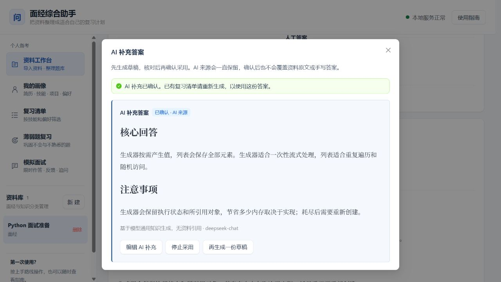
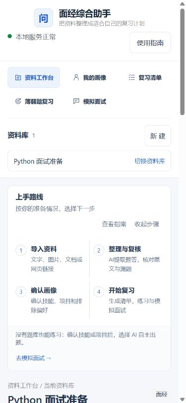

# AI补充答案

2026-10-26，用户授权将此前延期的AI答案生成加入当前开发。本功能面向题库中的单道题，入口在题库与复习相关页面；安装后无需另配一套模型，沿用 `TEXT_MODEL_PROVIDER`。

## 生成与来源

用户主动点击生成，后台返回AI草稿。草稿可以编辑保存、编辑后确认采用、直接确认，或丢弃。来源始终为 `AI_GENERATED`，确认或人工修改不把它改成资料原文或纯手写答案。

AI结果与主答案独立存储。资料或手写主答案优先；没有主答案时，当前已确认AI结果可作为后备。新的草稿、失败任务或被丢弃的新稿，不会替代旧的有效确认版。用户明确停止采用某份确认版后，该版本退出有效答案选择。

生成上下文包括当前题目、必要的本题资料片段及勾选的上下文。画像仅包含必要结构化信息，默认不发送完整简历；私人题目备注需用户明确勾选。没有资料依据时允许生成明确标注的一般知识参考，不伪造出处。涉及实际项目经历时，提示按真实情况填写，不虚构个人经历。

模型生成、资料原文抽取、模拟面试反馈是独立操作。自动整理仍只提取原文已有答案；面试反馈仍针对当次作答，不能把AI参考当作权威标准。

## 有效性与消费链路

生成结果绑定题目版本与使用到的上下文。题目、画像、偏好、备注或引用资料发生相关变化后，旧结果标为过期，保留供查看。

- 题库：草稿单独展示，只有有效确认结果可在无主答案时计入有答案。
- 复习清单：保存有效答案和来源快照；确认、修改、停止采用或过期后，已有清单提示需要更新。
- 薄弱题：保留答案来源，AI版本变化进入内容变更核对，不与原答案版本编号混用。
- Markdown导出：已确认且适用的AI答案标为AI补充；草稿不作为默认正式答案导出，历史快照保留历史来源。
- 模拟面试：如使用AI补充作参考，保留来源说明，反馈把它作为辅助材料。

## 任务与配额

新表 `ai_answer_runs` 保存用户、题目、输入指纹、任务状态、复核状态、结果与版本、模型、使用的来源及重试信息。推荐与学习记录分别保存AI答案ID/版本，不冒用主答案ID或版本。

任务状态为排队、处理中、成功或失败；草稿复核状态为待核对、已确认或已丢弃。幂等请求、用户隔离和后台任务令牌避免重复任务和过期写入。

默认每用户每天最多30次显式生成/重试、同时1个生成任务、单任务最多3次手动重试。可在 `infra/.env` 修改：

```dotenv
AI_ANSWER_DAILY_LIMIT=30
AI_ANSWER_CONCURRENCY_LIMIT=1
AI_ANSWER_RETRY_LIMIT=3
```

调整后重新创建API与Worker容器。补答采用按需单题调用，本版本不提供批量补答或网络主动搜索。

## 升级与使用

数据库迁移为 `20261026_0021`。升级前先备份，确认没有正在进行的解析、出题、回答反馈或补答任务，再重建服务。备份脚本也会检查 `ai_answer_runs` 的排队与处理状态。

完整操作步骤见[使用手册](../使用手册.md)，启动及备份见[启动步骤](../启动步骤.md)。前端保留明确的AI来源标签，并提供应用内指南。

## 验收记录

2026-10-26：后端完整隔离回归 **439 passed**（包括14项新增AI补答专项），测试数据库已自动删除；前端 lint、TypeScript 和生产构建通过，仍有既有的大包提示。

真实 DeepSeek 合成题验收2例：无来源的Python生成器题得到通用知识答案；有给定来源的题得到2处逐字匹配引文。模型缺少依据类型字段时，服务端按已校验引文推导类型，仍拒绝未知ID或不匹配引用，不额外增加模型调用。该验收证明调用和引用链路，不保证所有AI内容正确；界面保留人工核对步骤。

浏览器使用独立临时数据库和合成资料，覆盖：指南导航、草稿生成、编辑后确认、确认后有答案计数增加、重新生成时旧确认保留、丢弃新稿后仍可管理旧确认版、复习清单AI来源、修改画像后有效答案即时失效。检查桌面与390px窄屏，未发现横向溢出。





发布与备份结果见本次工作记录 `.planning/2026-10-26-ai-answers-and-ux/progress.md`。
