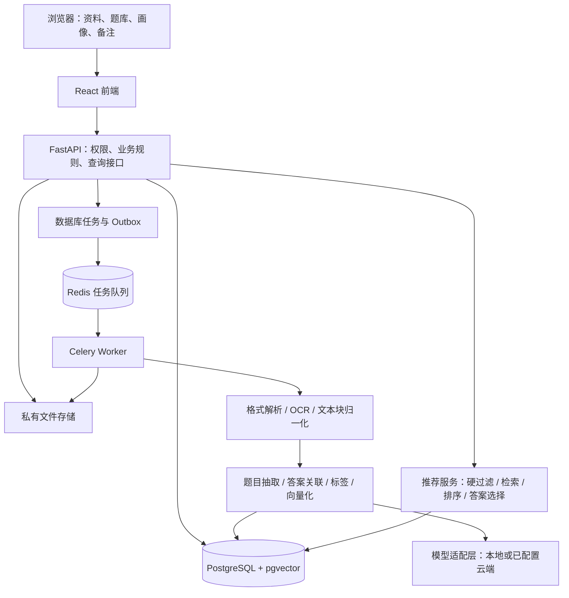
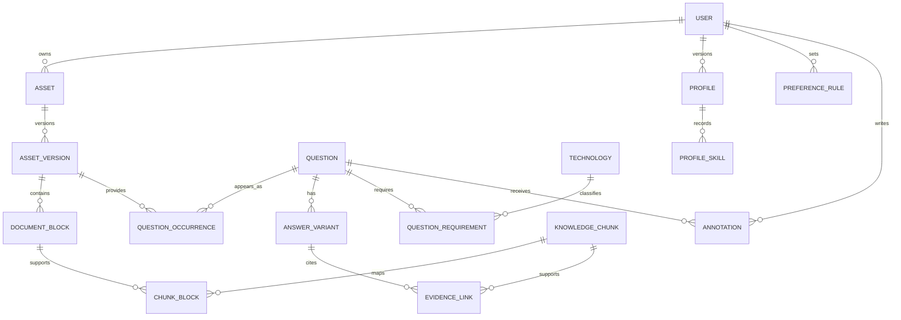

# 面经综合助手：架构与技术选型设计

> 设计日期：2026-10-20
> 文档状态：初始架构设计与历史范围记录。P1–P4 于 2026-10-24 完成当时范围的验收；此后增量功能及当前边界以 [README](./README.md)、[使用手册](./使用手册.md)和[改进路线](./tasks/改进路线.md)为准，不能将下文的全部设计建议理解为已实现。
> 项目位置：`E:\personalbagu`
> 默认前提：首版为本机个人使用，中文资料为主，以 Web 应用呈现；后续计划开源到 GitHub 供他人下载使用，因此 API Key、数据库与文件路径均通过环境变量配置。文中的规模、阈值和工期均为初始建议，需用实际资料验证。

### 当前实现说明（2026-10-26）

- 原技能和偏好筛选保留；已增加项目关联、文字模拟面试、人工掌握状态与薄弱题复习、批量链接导入。用户于 2026-10-26 重新授权后，按需单题 AI 补充答案也已实现，草稿需确认采用并持续标注 AI 来源。下文“AI 答案或模拟面试不属于当前版本”等表述保留为当时的范围记录，现由[AI 补充答案说明](./docs/AI补充答案.md)及改进路线替代。
- 实际解析使用 pypdf、python-docx、Trafilatura、LibreOffice 和 Poppler；文字模型及 OCR 分别显式选择 GLM 或 DeepSeek，失败不自动切换服务商。下文 Docling、统一模型网关及自动降级等内容属于设计建议，不代表当前实现。
- 当前搜索为关键词搜索，向量配置仍预留；尚未实现全知识库的语义检索和自动答案匹配。AI 补答使用当前题目关联的可用资料片段及用户选定的结构化上下文，不等于检索全部知识库。原设计中的逐资料“仅本地处理”开关也尚未实现。
- 长截图、真实扫描 PDF 和图文混排 Word 仍缺用户真实样本验收，不能据已验收普通截图和文本文件推断这三类质量已验证。完整范围复查见[功能完整性复查](./docs/2026-10-26功能完整性复查.md)。

## 1. 产品目标与边界

这个助手需要把分散的面经、八股文知识库和个人简历，整理成一份适合当前用户复习的问答集合。

当前版本的完整流程是：**导入资料 → 提取文字与问题 → 标记有答案/无答案 → 整理、关联资料中已有答案 → 解析简历和偏好 → 筛选适合的问题与答案 → 阅读、备注、纠错。** AI 答案生成作为下一版本功能单独实施。

### 1.1 核心需求

| 需求 | 设计中的具体行为 |
| --- | --- |
| 多格式资料导入 | 支持粘贴文字、TXT/Markdown、图片、网页链接、Word 和 PDF |
| 从图片识别问题 | 识别截图中的文字，再识别题目、回答、面试叙述与代码；不能只识字而不整理 |
| 首期只展示文字 | 题干、答案、代码、表格文字、出处和备注都以文本呈现；原文件保留供追溯 |
| 问答使用不同字体 | 问题使用黑体类字体，答案使用宋体类字体，代码使用等宽字体；同时用“问题/答案”标签区分 |
| 利用内部知识库 | 面经提供“考什么”，内部知识库优先提供“如何回答” |
| 按简历筛选 | Python 用户默认不推荐 Java 专属题；通用算法和计算机基础仍可保留 |
| 根据备注排除 | “不会 MySQL，不考虑”形成明确的 MySQL 排除规则 |
| 个人备注与纠错 | 支持给题目写笔记、修改识别错误、调整标签、纠正答案 |
| 可解释 | 能回答“为什么推荐这道题”“为什么被排除”“答案从哪里来” |

### 1.2 首期范围

首期做一个可持续使用的个人资料工具：资料管理、异步解析、题库、答案来源、简历画像、偏好筛选、个人备注和检索。无答案问题保留缺失状态，当前版本不生成新答案。

暂不纳入首期：语音模拟面试、视频解析、自动登录第三方网站、全网自动采集、复杂学习计划、支付系统、公开题库社区和多智能体自治工作流。这些功能不会影响当前核心架构，但会增加首期开发成本。

需要区分两个入口：

- **全部资料/题库**：保存所有已导入且有权查看的内容。
- **我的复习清单**：按照当前简历和偏好筛选后的结果。

排除 Java 或 MySQL 只是影响复习清单，不应删除原始资料。

## 2. 推荐方案与技术栈

建议采用：**React + TypeScript 前端，FastAPI 后端，PostgreSQL + pgvector 数据层，Celery + Redis 后台任务，Docling + 智谱 `glm-ocr` 文档识别，以及可替换的模型适配层（默认 GLM、DeepSeek 降级）。**

整体采用“模块化单体 + 独立后台 Worker”：业务代码放在同一个仓库，API 和 Worker 分进程运行。首期不拆微服务，不单独维护向量数据库，不训练自己的大模型。

### 2.1 主要技术选择

| 层次 | 首选 | 用途与选择理由 |
| --- | --- | --- |
| 前端语言/框架 | TypeScript + React + Vite | 适合资料列表、编辑表单和问答阅读等交互页面；首期没有搜索引擎收录需求，使用单页应用即可 |
| 页面组件 | Ant Design | 优先完成上传、表格、表单、抽屉和状态提示；问答阅读区域独立设计样式 |
| 前端数据状态 | TanStack Query；少量页面状态用 React 自带能力 | 管理题库查询、任务轮询、缓存失效，避免重复手写请求状态逻辑 |
| 文本呈现 | react-markdown + remark-gfm，限制允许的节点 | 支持列表、代码、表格；不直接执行资料中的 HTML、脚本或远程图片 |
| 后端 | Python + FastAPI + Pydantic | 接口、输入校验、OpenAPI 合约；解析/OCR/模型相关代码统一使用 Python |
| 数据访问 | SQLAlchemy + Alembic | 关系建模、事务、数据库迁移 |
| 主数据库 | PostgreSQL | 保存资料元数据、题目、答案、用户画像、备注、任务和访问权限 |
| 语义检索 | pgvector | 在 PostgreSQL 内保存向量；先采用精确检索，数据增大后评估 HNSW 索引 |
| 中文关键词检索 | 应用侧中文分词 + PostgreSQL 全文检索 | 与向量检索互补；维护 Python、MySQL、GIL 等领域词典 |
| 任务处理 | Celery + Redis | 运行 OCR、文档解析、题目抽取、向量化、答案整理等耗时任务 |
| 文档解析 | pypdf + python-docx + LibreOffice | P2 用较小依赖完成 PDF 文字层、DOCX 段落/表格/图片与旧 DOC 转换；后续需要复杂版面坐标时再评估 Docling |
| 图片 OCR | 智谱 `glm-ocr` API | P2 将图片和扫描页转为 Markdown；复杂图片的视觉模型复核留给后续阶段 |
| 网页提取 | 固定 IP HTTP + Trafilatura + 隔离 Playwright/Chromium | 静态正文优先；空正文或 JavaScript 外壳自动进入无密钥浏览器容器，所有浏览器请求继续校验公网地址，再交给同一正文解析器 |
| 旧 Word | 隔离运行的 LibreOffice 转换任务 | 将 `.doc` 转换为可处理格式，保留原件和转换记录 |
| 原文件存储 | 首期私有磁盘目录；后续 S3 兼容对象存储 | 文档原件、图片和解析产物不放入数据库大字段；存储路径不直接对外公开 |
| 模型调用 | 自定义 `ModelGateway`，接智谱 GLM 与 DeepSeek 两家 API | 统一处理结构化输出、超时、重试、使用量；文本模型可配置，默认 GLM、DeepSeek 降级 |
| 开发/部署 | Docker Compose + Linux 容器 | 同时运行前端、API、Worker、PostgreSQL、Redis；Windows 通过 WSL2/Docker 开发 |
| 验证 | pytest、前端组件测试、Playwright 端到端测试 | 检验规则、解析质量、权限、失败恢复和真实使用流程 |

Vite 提供 React/TypeScript 模板和静态产物构建能力；TanStack Query 负责服务端状态的获取、缓存与同步，符合此处的前端分工。[Vite 官方指南](https://vite.dev/guide/)、[TanStack Query 官方说明](https://tanstack.com/query/latest/docs/framework/react/overview)。

### 2.2 模型如何选择

这里有四类不同任务，不必让同一个大模型承担全部工作：

| 任务 | 推荐策略 | 选型验证重点 |
| --- | --- | --- |
| OCR | 智谱 `glm-ocr` 专用 OCR API 为默认路径 | 中文、英文技术词、代码缩进、长截图、低清图片 |
| 抽取和整理 | 能稳定输出 JSON 的中文文本模型，默认 GLM、可切换 DeepSeek | 题答配对、叙述归纳、标签分类、结构化输出合格率 |
| 向量表示 | SiliconFlow 托管的 `BAAI/bge-m3`（DeepSeek 无 embedding 接口） | 同义问题召回、中文问题与英文术语匹配 |
| 复杂图片复核 | 可选视觉模型 `glm-4v-flash`（免费）或 `deepseek-flash` | 仅复核 OCR 失败区域；有成本限制 |

embedding 使用 SiliconFlow 托管的 BGE-M3（模型 ID `BAAI/bge-m3`）；DeepSeek 官方 API 不提供 embedding 接口，因此不采用 DeepSeek 做向量表示。若后续希望完全本地化，可回退到本地 BGE-M3。[BGE-M3 官方模型卡](https://huggingface.co/BAAI/bge-m3)。

文本生成模型采用可配置的 `ModelGateway`：通过 `TEXT_MODEL_PROVIDER=glm|deepseek` 显式选择智谱 GLM 或 DeepSeek，OCR 由 `OCR_PROVIDER` 独立选择；服务失败时不自动切换供应商。默认模型、模型 ID 与 API Key 均通过环境变量配置，方便他人下载后自行替换。接口兼容不代表结构化输出、图像输入、上下文长度和计费方式完全相同，应由适配层处理差异。

**当前采用云端 API 优先，默认允许简历与内部知识库发往已配置的模型服务。** 仍保留“每份资料的处理策略”字段与 `ModelGateway` 策略检查，便于以后按资料收紧为本地限定，但不能在未配置时悄悄回退到其他模型。模型服务不可用时，系统仍可保存资料，并将智能整理标为“等待模型配置”。

### 2.3 为什么暂不选择其他架构

| 备选 | 当前取舍 | 何时再考虑 |
| --- | --- | --- |
| Next.js 全栈 | 当前没有 SSR/SEO 的明确需求，解析工作仍需要 Python 服务，增加一套服务端业务层收益有限 | 需要公开内容页、SEO，或团队已有 Next.js 经验 |
| Streamlit | 适合解析效果验证；长任务管理、精细问答阅读和后续权限扩展用独立前后端更清晰 | 只做短期实验原型 |
| Django | 可行；若大量依赖后台管理和账户功能可能更省事，本方案优先 API 与解析流水线 | 团队熟悉 Django、管理后台比阅读体验更重要 |
| Elasticsearch / 独立向量库 | 首期在 PostgreSQL 内完成检索，减少运维和数据同步 | 数据与检索压力经测量超过 PostgreSQL 方案的成本/延迟目标 |
| LangChain / LlamaIndex | 不作为首期必需依赖；流程较固定，显式业务函数更易定位问题 | 多种检索器或流程复用已经形成实际需求 |
| 微服务 / Kubernetes | 首期维护成本高于收益 | 多团队独立开发、明显不同的扩容需求或运维要求 |
| 模型微调 | 现阶段缺少高质量标注集，先用结构化抽取和检索增强 | 已有稳定评测与足量标注，且提示词/检索优化仍无法满足目标 |

## 3. 总体架构与模块分工



`Outbox` 是与任务记录一起写入数据库的待投递事件。调度器将事件投递到队列，避免“数据库已记录上传成功，但进程在入队前退出，任务永久不执行”。任务详情以 PostgreSQL 为准，Redis 不是资料的长期存储。

### 3.1 业务模块

| 模块 | 主要职责 | 不承担的职责 |
| --- | --- | --- |
| `assets` | 上传、URL 导入、原件、版本、删除 | 不直接生成答案 |
| `ingestion` | 解析、OCR、分块、任务状态与重试 | 不决定用户是否应学习某技术 |
| `questions` | 题干抽取、规范化、去重、来源关联 | 不覆盖原始问法 |
| `knowledge` | 知识库文本块、答案版本、引用与可信状态 | 不把模型生成内容冒充原文 |
| `profiles` | 简历解析、技能事实、筛选偏好 | 不将简历缺失字段自动判为“不会” |
| `recommendations` | 硬过滤、排序、答案适配、推荐解释 | 不自行放宽用户排除规则 |
| `annotations` | 每题备注、答案笔记、收藏和掌握状态 | 不把普通笔记自动变成全局规则 |
| `model_gateway` | 模型接入、输出校验、超时、用量、版本记录 | 不向模型开放数据库或任意网络操作权限 |

API 与 Worker 共用这些领域模块；路由层只做请求校验和调用。CPU 密集解析不放在 API 进程中。FastAPI 官方也建议对重型后台计算考虑 Celery 等工具。[FastAPI 后台任务说明](https://fastapi.tiangolo.com/tutorial/background-tasks/)。

## 4. 多格式资料导入设计

### 4.1 导入时先标明资料用途

同一种 PDF 可能是面经、八股知识库或简历，用途不同，后续处理也不同。上传时提供三个选项：

- **面经**：主要抽取问题、上下文，以及资料中真实存在的答案。
- **知识库**：主要提取知识片段与现成问答，为其他问题提供答案依据。
- **简历**：主要提取技能、项目、岗位和经验，不自动加入可检索题库。

允许修改用途并创建新的处理版本。资料没有说明公司、岗位或面试日期时保留为空，不能让模型猜测这些信息。

### 4.2 各种格式的处理路线

| 输入 | 处理方式 | 关键边界 |
| --- | --- | --- |
| 粘贴文字、TXT、Markdown | 按段落、标题、列表、代码块解析 | 保留题号、缩进、字符范围；不经过 OCR |
| 图片/截图 | OCR → 阅读顺序恢复 → 问题抽取 | 长截图分片并设置重叠，合并边界重复文字；低清结果进入复核 |
| 文本 PDF | 提取文字层、布局和章节；检查图片区域 | 有文字层不代表整页都无需 OCR |
| 扫描/混合 PDF | 按页、必要时按区域决定 OCR | 防止漏掉“正文是文本、题目是截图”的内容，核对总页数与实际处理页数 |
| DOCX | 提取段落、标题、表格；对内嵌图片补充 OCR | 文本与图片按文档顺序关联；使用段落/表格定位，避免伪造页码 |
| 旧 DOC | 隔离 LibreOffice 转换 → 统一解析 | 转换失败明确提示另存为 DOCX/PDF，不静默跳过 |
| 网页链接 | 安全获取 HTML → 正文提取 → 必要时隔离浏览器渲染 → 正文提取 | 记录最终 URL、抓取时间和内容快照；不处理登录/验证码绕过，只导入单页 |

Docling 官方支持格式列表包含 PDF、DOCX、图片等，也列出了依赖 LibreOffice 的旧 `.doc` 支持。实现时应固定版本验证，而不是假定所有格式在任意安装配置下都可用。[Docling 支持格式](https://docling-project.github.io/docling/usage/supported_formats/)。

截图使用智谱 `glm-ocr` 输出的文字与结构作为原始识别记录，必要时用 `glm-4v-flash` / `deepseek-flash` 视觉模型复核失败区域。调用具体流水线或服务时要核对多页处理配置，防止默认页数上限造成内容遗漏。[智谱 GLM 开放文档](https://docs.bigmodel.cn/)。

网页正文提取选用 Trafilatura。P2.5 已接入独立的受限 Playwright/Chromium 服务：静态提取为空或识别到 JavaScript 空壳时自动渲染，渲染器不接触数据库、文件和模型密钥。需要登录、验证码，或当前章节没有体现在 URL 中的页面，明确提示改用粘贴内容或上传文件。[Trafilatura 使用说明](https://trafilatura.readthedocs.io/en/latest/usage-python.html)。

### 4.3 统一中间结构

所有格式先归一化为 `DocumentBlock`，之后再进入题目抽取。这样不会为 PDF、图片和 Word 各写一套推荐逻辑。

```json
{
  "blockId": "block_001",
  "assetVersionId": "asset_v1",
  "type": "PARAGRAPH",
  "rawText": "接着问了Python生成器和迭代器的区别",
  "normalizedText": "接着问了 Python 生成器和迭代器的区别",
  "order": 12,
  "sectionPath": ["一面", "Python基础"],
  "locator": {
    "kind": "PDF_REGION",
    "pageNumber": 3,
    "bbox": [0.10, 0.20, 0.90, 0.28]
  },
  "extractionMethod": "OCR",
  "ocrScore": 0.94,
  "reviewStatus": "UNREVIEWED"
}
```

以上仅为结构示例，不是实际识别结果。应用统一使用从 1 开始的页码、左上角为原点的归一化坐标，适配器负责转换不同解析器的坐标约定。`locator` 根据格式切换为图片区域、DOCX 段落/表格、HTML 节点和文本字符范围；不可获得的值为空。

原文和清洗文本分别保存，不能只保留修改后的文字。Docling 的统一文档模型提供结构及溯源基础，但布局信息仅在可获得时存在，应用仍需定义自己的可空定位字段。[Docling 文档模型](https://docling-project.github.io/docling/concepts/docling_document/)。

### 4.4 异步任务与失败恢复

```text
QUEUED → PARSING → EXTRACTING → INDEXING → READY
                             ├→ NEEDS_REVIEW
                             ├→ PARTIAL_SUCCESS
                             └→ FAILED
任一执行阶段还可进入 CANCEL_REQUESTED → CANCELLED
```

数据库分别记录 `stage`、`status`、已处理页数、总页数、错误代码和重试次数。未确认总页数前显示“正在分析”，不显示虚假的完成百分比。`PARTIAL_SUCCESS` 必须列出失败页或图片；未完成复核的题目不默认进入复习清单。

建议初始限制为单文件 25 MB、单 PDF 100 页；均做成配置。超限在上传前后双重提示，不截断后声称成功。加密文件、损坏文件、格式不支持和网页访问受限不进行无意义的自动重试；网络瞬断和供应商限流采用有上限的退避重试，例如最多 3 次。

幂等分两层：

1. 同一用户重复提交同一个请求，按 `Idempotency-Key` 返回同一任务。
2. 文件处理按“所属用户 + 内容哈希 + 用途 + 流水线版本 + 处理配置哈希”复用结果；改变用途或解析配置可产生新版本。

Worker 按阶段保存检查点，通过唯一键防止重复写入。队列允许重复投递，业务不能因此重复生成题目。任务使用租约和心跳识别中断；取消和删除设置终止标记，Worker 在提交阶段结果前重新检查，避免已删除资料被任务重新写回。

## 5. 题目与答案的整理方式

### 5.1 从原文中提取什么

题目抽取要支持两种来源：

- 直接问题：“Python 的生成器和迭代器有什么区别？”
- 面试叙述：“后面问了生成器、迭代器，还有 GIL。”

后者可归纳成候选题，但必须标记 `INFERRED_FROM_NARRATIVE` 并保留原句。“问了 Redis”不足以推断具体考了持久化、集群还是缓存穿透，应保留为待细化话题，不生成多个虚构面试题。

模型输出由 Pydantic/JSON Schema 校验，至少包含：原始问法、规范题干、来源块 ID、来源类型、问题类型、技术依赖、概念标签、资料中是否存在对应答案、复核标记。输出无效时有限重试，仍无效则保留文本供人工整理。

**OCR 识别分数、题目抽取置信度、答案证据覆盖和人工校验状态分开保存。** 模型自报的置信度仅能辅助排队，不能直接视为事实准确率。

### 5.2 题目去重与来源保留

先统一空白、标点与技术别名，再进行精确匹配；语义近似匹配只产生候选合并关系。合并前检查核心概念、必需技术、版本和考察点。

“什么是 Python GIL”与“解释 CPython 的 GIL”可能合并；“Java HashMap”与“Python dict”不能因为都涉及哈希表就合并为一题。不同版本行为明显不同的题也需保留差异。

数据上使用：**规范题目 `Question` + 每次出现记录 `QuestionOccurrence`**。同一道题出现在多份面经时只显示一个规范题，但仍能展开多个出处。来源次数按去重后的独立资料统计，避免同一文章反复上传虚增热度；这里只表示当前资料库出现频率，不代表行业真实面试概率。

### 5.3 答案来源与优先级

| 答案类型 | 含义 | 展示标签 |
| --- | --- | --- |
| `ORIGINAL` | 资料中原本就有的答案 | 原文答案 |
| `CURATED` | 用户内部知识库或手动整理的答案 | 知识库答案；另显示是否已核验 |
| `RAG_GENERATED` | 下一版本：根据检索到的知识片段生成的解释 | AI 整理，附引用 |
| `ADAPTED` | 下一版本：针对用户语言/技术栈改写的答案 | 适配答案，待校验或已核验 |
| `UNSUPPORTED_DRAFT` | 下一版本预留：缺少资料依据、用户主动要求生成的草稿 | AI 草稿，无资料依据 |

当前版本选择默认答案的顺序为：**用户明确选定且适配的答案 → 人工核验且适配的知识库答案 → 有来源且适配的现有答案。** 下一版本加入 AI 草稿后，未确认草稿仍排在所有可靠来源之后。“内部整理”表示来源，不能自动等同于正确或最新。

当原面经只有问题时，`originalAnswer` 必须为空。知识库没有足够依据时显示“尚无可靠答案”，允许用户补充。默认不使用无依据草稿填满题库。

同一道题允许多份答案并存，保存适用语言、技术版本、更新时间、复核状态和引用。资料互相矛盾时展示冲突，不把相反说法拼成一个看似确定的结论。用户修订产生新的答案版本，原文保持不变。

### 5.4 有答案与无答案的分类

P3 对每道题计算一个面向界面的 `answerState`，用于“全部 / 有答案 / 无答案”筛选：

| `answerState` | 判定 | 界面含义 |
| --- | --- | --- |
| `MISSING` | 没有任何可用答案版本 | 无答案；只展示问题、出处和备注 |
| `SOURCE_ANSWER` | 存在原文、知识库或用户手写答案，但尚未明确核验 | 有答案；显示真实来源 |
| `AI_DRAFT` | 下一版本预留：只有尚未确认的 AI 候选答案 | 有答案，同时醒目标记“AI 草稿” |
| `VERIFIED` | 用户明确确认了当前选定答案 | 有答案；显示核验人与时间 |

`answerState` 是由答案版本的 `source_type`、`review_status` 和有效性计算出的展示状态，不作为另一份可被独立修改的事实保存，避免删除答案或撤销引用后状态不同步。当前版本只产生 `MISSING`、`SOURCE_ANSWER` 和人工确认后的 `VERIFIED`；`AI_DRAFT` 保留给下一版本。

“有答案”表示资料中存在可展示内容，不等于内容已经正确。列表继续分别显示答案来源与核验状态；被拒绝或失去全部依据的答案不计入 `answerState`。个性化清单另计算 `usableAnswerState=ANSWERED/MISSING`：答案可能确实存在，但因语言、框架或排除偏好不适合当前用户。此时界面显示“有来源答案，但当前不适用”，不能把它说成资料原本没有答案。

## 6. 简历、备注与个性化筛选

这一部分是产品最重要的业务逻辑。推荐采用：**模型提取候选信息，用户可以修正，确定性规则执行硬过滤，检索与评分负责排序。**

### 6.1 画像分为三类信息

| 类别 | 示例 | 用途 |
| --- | --- | --- |
| 简历事实 | Python、FastAPI、做过爬虫项目 | 提供匹配证据，不直接代表能力考核结果 |
| 全局偏好 | 不考虑 MySQL；优先 Python；目标后端岗位 | 控制整个复习清单的范围和排序 |
| 每题备注 | “这里的锁机制没理解”“回答时补项目例子” | 个人学习记录，默认不改变全局筛选 |

简历解析得到的每项技能都保存证据片段、来源版本、是否由用户确认。简历里的“项目使用了 MySQL”不自动等于“精通 MySQL”；没有写 Java 也不自动等于“不会 Java”。

上传简历后展示可编辑的技能卡片。用户可以直接新增或移除技能，不必重新上传整份简历。明确的用户设置优先于简历提取，简历提取优先于模型间接推断。

### 6.2 用户画像示例

```json
{
  "profileVersion": 7,
  "targetRole": "Python后端开发",
  "skills": [
    {"technologyId": "python", "source": "RESUME", "confirmed": true},
    {"technologyId": "fastapi", "source": "USER", "confirmed": true}
  ],
  "preferences": {
    "languageMode": "PROFILE_MATCHED",
    "preferredLanguages": ["python"],
    "hardExcludes": ["mysql"],
    "includeGeneralFundamentals": true
  }
}
```

`PROFILE_MATCHED` 表示语言专属题进入与画像相符的语言池；Java 未匹配时不进入默认清单，但数据库不用把 Java 写成“用户不会”。

### 6.3 自然语言备注转成规则

界面提供“筛选偏好”输入框，并把解析结果显示为可删除的规则标签：

| 用户输入 | 结构化结果 | 默认影响 |
| --- | --- | --- |
| 我只会 Python，不考虑 Java | Python 为适配语言；Java 硬排除 | 排除 Java 专属题及必须用 Java 回答的答案 |
| 我不会 MySQL，不要相关题 | MySQL 硬排除 | 排除 MySQL、InnoDB 专属内容 |
| 数据库都不考虑 | database 类目及其明确子项硬排除 | 比仅排除 MySQL 的范围更大 |
| Redis 不熟，想重点补一下 | Redis 学习目标、提高优先级 | 不排除 Redis |
| 这题我不会 | 当前题的掌握状态为待学习 | 不改变全局技术范围 |

按照本需求，用户在“筛选偏好”中表示“不会 MySQL”时，默认解释为暂时不考虑，并清楚显示“已排除 MySQL，可修改”。若句子同时出现“不熟但想学习”等相反语义，则生成待确认规则，不猜测用户意图。

无需每次简单输入都弹确认框；显式规则可直接应用并提供撤销。歧义和同一技术的互相冲突指令才要求用户选择。新简历不会清空旧偏好；同一份简历说会 MySQL、用户备注要求排除 MySQL 时，后者生效。

新简历设为当前版本时，替换旧简历自动提取的活动技能事实，不将历次简历技能无限累加；用户手工添加的技能和明确偏好继续保留。删除简历时清理其原文证据及未被用户另行确认保留的派生技能，重建画像并使推荐失效。用户选择保留的技能转为手工事实，不继续保存已删除简历的敏感摘录。

### 6.4 技术标签不能只是字符串

建立小型、可维护的技术字典，包含规范 ID、名称、别名、类别和关系。例如：

```text
programming_language: python / java / javascript
database: mysql / postgresql / sqlite
mysql 的实现相关技术: innodb
framework: fastapi / django / spring
general_concept: hash_table / transaction / http / process_thread
```

`Java` 与 `JavaScript` 是独立 ID，不能用子字符串匹配。`MySQL` 与通用的 `SQL`、`事务` 也不能直接画等号。关系至少区分“类别的子项”和“相关概念”，排除规则只沿配置好的排除关系传播，不沿所有相关边扩散。

另外维护知识领域标签，例如 `database`、`network`、`operating_system`。规则分为“技术排除”和“领域排除”：排除 MySQL 只影响该技术及其专属实现；排除数据库领域还会排除 ACID、通用 SQL 等数据库知识。题目、答案和知识片段都保存领域标签，不能只依靠技术依赖判断大类排除。

每道题区分以下标签角色：

- **必需技术**：回答本题必须了解的技术，如 JVM、MySQL/InnoDB。
- **核心概念**：哈希表、并发、索引、事务。
- **示例技术**：原材料只是使用 Java 代码举例。
- **背景提及**：题目介绍中提到了某技术，但不是考察点。

首期可用 `requiredTechnologyIds` 表示共同必要条件。只有可任选实现的题使用明确的替代技术组，例如“Python 或 Java 实现”，而“比较 Python 和 Java”必须同时依赖两者，不能误标为任选其一。

### 6.5 筛选与排序顺序

```text
1. 限定当前用户可访问、状态可用的资料和题目
2. 排除命中硬规则的题目必需技术或知识领域
3. 执行语言适配与其他明确范围限制
4. 保留与画像直接相关的题，以及启用的通用基础题
5. 对候选题做关键词/语义召回和相关性排序
6. 为每题选择符合相同规则的答案变体
7. 对最终题干、答案和代码依赖再校验
8. 返回题目、答案或答案缺失状态，以及推荐/排除原因
```

没有出现在简历中的技术专属题，默认不进入“直接匹配”分组；可另列“待确认/拓展学习”，但不混入严格复习清单。通用算法、网络、操作系统、数据结构不因简历漏写而全部删除。没有可用画像时提示补充技能，并允许先看通用基础。

硬排除不能由热度、岗位相关性或模型建议抵消。若最终没有题目，解释哪些规则缩小了范围，不自动恢复被排除的内容。

初期排序可采用如下可配置权重，所有分项先归一化到 0–1：

```text
得分 = 0.40 × 技能相关性
     + 0.25 × 简历项目相关性
     + 0.15 × 目标岗位相关性
     + 0.10 × 当前资料库去重后的出现频率
     + 0.10 × 用户显式复习优先级
```

这只是启动参数，不是经过验证的最佳权重。先用人工标注的推荐样本调节；首期没有岗位信息的分项应按既定规则重新归一化，不随机填值。暂不需要训练专用推荐模型。

### 6.6 用具体问题检验规则

假设用户简历只有 Python，并明确排除 MySQL：

| 问题/答案 | 处理结果 | 原因 |
| --- | --- | --- |
| Python 装饰器的原理 | 推荐 | 直接匹配 Python |
| JVM 垃圾回收机制 | 不推荐 | Java 专属技术未匹配 |
| InnoDB 的聚簇索引 | 不推荐 | 命中 MySQL 硬排除 |
| HTTP 与 HTTPS 的区别 | 可推荐 | 通用基础知识 |
| 什么是事务的 ACID | 可推荐通用答案 | 排除 MySQL 不等于排除数据库理论 |
| 如何判断链表有环，原答案是 Java 代码 | 题目可保留；选择 Python/通用答案 | 语言只是实现示例 |
| 比较 Python 和 Java 的并发模型 | 默认不推荐 | 完整回答同时依赖两个语言体系 |
| 题干为“索引如何加速查询”，答案全是 InnoDB 细节 | 更换通用答案，否则显示暂无适配答案 | 题干通过不代表答案通过 |

答案适配不是把 `Java` 字样替换为 `Python`。当前版本只能选择已有的 Python 或通用答案；没有适配答案时保持缺失。下一版本可以为通用算法生成 Python 实现候选并做运行验证；JVM、Java 内存模型等不能“翻译”成同一道 Python 题。

混合问题只有在语义可独立、证据足够的情况下才能拆出子题，并记录父题和来源。推荐记录保存画像版本、规则版本、所选答案及原因，方便排查“为什么我还看到 MySQL”。

## 7. 知识检索与下一版本 AI 答案生成

当前版本实现题目搜索、相似题辅助整理和已有知识答案匹配；第 7.4–7.5 节的 AI 答案生成与生成缓存只保留为下一版本技术方向。当前版本不会根据无答案问题自动或手动生成新答案。

### 7.1 两类检索对象

| 对象 | 用来解决的问题 | 索引内容 |
| --- | --- | --- |
| 问题索引 | 找出适合复习或相似的题目 | 规范题干、别名、概念、技术要求 |
| 知识片段索引 | 给某道题找到答案依据 | 章节、正文、表格文字、代码说明及其出处 |

面经和知识库允许互相补充，但不要把简历默认纳入答案知识检索，避免回答意外暴露个人信息。

### 7.2 知识片段如何切分

优先按标题层级、完整问答对、段落和代码块切分。起步可将普通片段控制在约 400–800 token，并为跨段语义设置少量重叠；这些长度由所选模型的 tokenizer 和评测修正。

完整题答、短表格和函数代码优先保持完整。每块保存章节路径和相邻块 ID；检索命中片段后可补取相邻上下文，避免只拿到“因此不适用”却缺少前面的条件。

### 7.3 混合检索流程

1. 应用资料权限和技术范围约束，形成有效候选集合。
2. 关键词检索识别 `GIL`、`B+树`、`asyncio` 等精确术语；向量检索找到不同措辞的相同概念。
3. 使用基于名次的融合方法（如 RRF）合并两路结果，避免直接相加不同量纲的原始分数。
4. 初期对约 20–40 个候选做规则排序；质量不足时再加入重排模型。
5. 选取少量相关片段供答案整理，校验引用有效性与技术适用范围。

知识片段也要标记必需技术、示例技术和知识领域，使用 `chunk_requirements` 支持检索前过滤。只排除 MySQL 时，通用事务解释可以命中，InnoDB 实现片段不能进入生成上下文；范围混杂的长片段先按语义拆分，无法可靠分离时不用于严格适配答案。题目/答案标签未知或存疑时进入待确认，不能默认当作无技术依赖。

中文检索不能假设 PostgreSQL 默认配置已完成符合业务需要的中文分词。方案采用应用侧中文分词、技术术语保护和自定义词典，再用一致的处理方式构造文档与查询。可从 jieba 开始验证；PostgreSQL 全文检索负责词项匹配，具体中文效果由测试集决定。[PostgreSQL 解析器文档](https://www.postgresql.org/docs/current/textsearch-parsers.html)、[jieba 官方项目](https://github.com/fxsjy/jieba)。

首期 pgvector 使用精确检索，先验证质量再优化速度。启用近似索引后，过滤条件可能导致返回数量不足；需评估迭代扫描、扩大扫描范围或对较小候选集回退精确检索。不能先跨所有用户取少量结果，再在应用层删除无权限结果。访问权限必须进入数据库查询，返回前再防御性检查。[pgvector 官方文档](https://github.com/pgvector/pgvector)。

### 7.4 下一版本：答案生成与证据校验

采用 RAG，即先检索已有资料，再依据资料整理答案。一次请求包含：规范题目、必要的技术限制、经过权限过滤的知识片段及片段 ID；不发送整份简历和整个知识库。

生成结果包含：简短回答、展开解释、可选代码、每段引用 ID、证据不足项。服务端检查引用 ID 真实存在且用户有权访问。引用存在只说明“找得到出处”，不代表内容真的被出处支持；关键结论还应做证据对应检查，重要或低质量结果进入人工复核。

检索不到可靠资料时保留缺失状态。必要时允许用户主动创建无依据草稿，界面保留明显标签。不要默认联网补答案；若以后加入，作为单独功能保存网页快照、时间和出处。

### 7.5 下一版本：生成时机、缓存与失效

导入时完成原文抽取、题目结构化、现成答案关联和向量索引。缺失答案在用户打开题目或主动点击“根据知识库整理”时异步生成；不要每上传一本书就为所有可能题目批量生成答案。

缓存键包含：用户/资料权限范围、问题版本、知识库版本、画像与偏好版本、模型和提示词版本、答案语言。个性化适配答案先保存在个人范围；不能把某人的简历项目描述写入公共答案。

知识片段编辑和答案修订均新增不可变版本；引用绑定准确的 `chunkVersionId` 或原始块版本，推荐快照绑定准确的 `answerVersionId`。界面可以展示当前答案，但旧引用不会因为更新正文而悄悄改变含义。不可变指不原地修改，不代表可以绕过用户删除资料的要求。

修改画像、编辑知识片段、撤回资料权限、删除来源或替换 embedding 模型时，应使受影响的推荐/答案缓存失效。更换 embedding 模型需要重建对应索引，不能混用不同模型空间，即使它们维数相同。

## 8. 数据模型设计

业务事实存 PostgreSQL；原文件和大体积解析产物存私有文件存储；向量与对应问题/片段的版本关联。建议数据库字段使用 `snake_case`，API 字段使用 `camelCase`，通过 Schema 转换。

### 8.1 主要实体

| 表/实体 | 主要字段 | 关系与用途 |
| --- | --- | --- |
| `users` | id、账户标识 | 首期只有一个本地用户也保留用户 ID |
| `collections` | id、owner_id、name、purpose、version | 面经库/知识库容器；多人共享时增加成员表 |
| `assets` | id、owner_id、collection_id、purpose、processing_policy、status | 一份逻辑资料；简历可不属于普通资料库 |
| `asset_versions` | asset_id、hash、object_key、source_url、fetched_at、pipeline_version | 原件、网页快照与解析版本 |
| `document_blocks` | asset_version_id、raw_text、normalized_text、locator、quality | 按格式归一化的文字块和来源定位 |
| `questions` | owner_id、canonical_text、type、domain_ids、status、version | 规范题目；首期在用户私有范围去重；`answerState` 从答案版本计算，不重复存真值 |
| `question_occurrences` | question_id、asset_version_id、原始问法、抽取方式、来源关系 | 多份资料出现同题仍保留各自证据 |
| `technologies` | id、name、aliases、category | 技术词典及明确的层级/依赖关系表 |
| `domains` / 内容领域关联 | id、name、parent_id；关联目标及版本 | 数据库、网络等领域；支持排除整个知识大类 |
| `question_requirements` | question_id、technology_id、role、requirement_group、evidence | 必需技术、可选实现和背景标签 |
| `knowledge_chunks` / `chunk_versions` | owner_id、collection_id、current_version_id；text、section_path、domain_ids | 逻辑片段与不可变内容版本，供检索与生成使用 |
| `chunk_blocks` | chunk_version_id、block_id、字符范围 | 保存片段版本到原始块的多对多映射 |
| `chunk_requirements` | chunk_version_id、technology_id、role | 为检索上下文执行技术依赖过滤 |
| `answer_variants` / `answer_versions` | question_id、owner_id、current_version_id；body、source_type、language、domain_ids、review_status | 一题多答案，每次修订新增不可变版本 |
| `answer_requirements` | answer_version_id、technology_id、role | 对答案依赖独立过滤，不能只检查题目 |
| `evidence_links` | question/answer_version 目标、block/chunk_version 来源、位置、引用类型 | 一个答案可关联多个资料；数据库约束目标与来源类型 |
| `question_embeddings` / `chunk_embeddings` | target_id、target_version_id、model_id、dimension、vector | 分别维护问题和知识片段索引 |
| `profiles` / `profile_skills` | user_id、version、skill_id、source、evidence、confirmed | 当前画像、历史版本与技能证据 |
| `preference_rules` | user_id、scope、effect、target_kind、target_id、source_text、version | 技术/领域的排除、优先、学习目标及可撤销历史 |
| `annotations` | user_id、question_id/answer_id、body、version | 每题/每答案的私人备注 |
| `learning_states` | user_id、question_id、status、updated_at | 可选的收藏、待学习、已掌握状态 |
| `recommendation_runs` / `recommendation_items` | user_id、profile_version、rules_version、question_id、question_version、answer_version_id、reason | 一次推荐快照及逐题解释 |
| `jobs` / `job_steps` / `outbox_events` | owner_id、type、status、stage、attempt、lease、error | 可恢复任务与可靠投递 |
| `idempotency_requests` | owner_id、key、request_hash、state、response_ref、expires_at | 同一请求重试不重复创建资源 |

表格是逻辑模型，开发时可以合并低频辅助表，但不要把题目、答案、来源和画像塞进一个难以更新的大 JSON。解析器原始响应可另存 JSONB，核心筛选字段需要结构化、可索引。

### 8.2 关系示意



示意图只展示主要关系；直接引用原始块以及答案技术依赖同样按上表实现。

### 8.3 必须保证的数据约束

- 所有私有资源及关联查询验证所属用户/资料库权限，包括答案引用、向量命中、任务、下载与推荐缓存。
- 每个来源定位指向不可变资料版本，重新解析不覆盖旧版本的引用。
- 知识片段、答案及其分类/依赖绑定准确内容版本；原始块纠错也生成新版本，历史引用不重定向到改写后的文本。
- 规范题合并和拆分需要保存映射，避免用户备注丢失。
- 人工修正保留独立版本；重跑模型不能覆盖用户已确认的内容。
- 同一任务阶段结果使用唯一约束，重复消息不生成重复 occurrence、答案或索引。
- 删除资料后立即取消其可见性、停止相关任务并使缓存失效，再异步清理原文件、片段、向量及派生内容。
- 多来源答案需重新检查剩余证据；失去全部依据的生成答案不能继续显示为“有来源”。用户自写笔记保留并提示关联来源已删除。
- 首期不做跨用户内容去重共享；相同文件哈希不能成为绕过权限的理由。
- 解析块、知识片段、向量和生成答案保留处理策略及来源依赖；派生内容的策略不能比任一来源更宽松。

## 9. 后端接口与异步交互

首期采用 REST + JSON，文件上传使用 multipart，鉴权下载返回文件流。API 前缀为 `/api/v1`，FastAPI/Pydantic 生成 OpenAPI，前端据此生成 TypeScript 类型。下面是接口设计草案，实际开发时补齐每个 Schema 的边界与枚举。

### 9.1 主要接口

| 方法与路径 | 输入合约摘要 | 输出合约摘要 |
| --- | --- | --- |
| `POST /assets` | file、purpose、可选 collectionId | `202 AssetTaskReceipt`：assetId、assetVersionId、jobId |
| `POST /text-imports` | title、text、purpose、可选 collectionId | `202 AssetTaskReceipt` |
| `POST /url-imports` | url、purpose、可选 collectionId | `202 AssetTaskReceipt` |
| `GET /assets` | cursor、pageSize、purpose、status | `Page<AssetSummary>` |
| `GET /assets/{id}` | 资料 ID | `AssetDetail`：用途、处理策略、版本、处理结果 |
| `GET /assets/{id}/download` | 可选 assetVersionId | 已鉴权的原文件流 |
| `GET /asset-versions/{id}/blocks` | cursor、pageSize | `Page<DocumentBlockView>`：文字、定位、质量与纠正状态 |
| `POST /asset-versions/{id}/corrections` | expectedCurrentVersion、corrections 数组，每项为 blockId/replacementText | `202 AssetTaskReceipt`：新修订版本及重处理任务 |
| `DELETE /assets/{id}` | 资源 ID | `202 JobReceipt`：清理任务；资料立即不可见 |
| `GET /jobs/{id}` | 任务 ID | `JobView`：status、stage、进度、错误、可重试性 |
| `PATCH /jobs/{id}` | expectedVersion、desiredStatus=`CANCELLED` | `JobView`：允许返回 CANCEL_REQUESTED |
| `POST /jobs/{id}/retries` | 失败任务 ID、可选 failedStepIds | `202 JobReceipt`；复用成功阶段 |
| `GET /questions` | cursor、pageSize、q、collectionId、technologyId、answerState=`ANY/ANSWERED/MISSING` | `Page<QuestionSummary>`；返回计算后的 answerState、答案来源和核验状态 |
| `POST /questions` | canonicalText、领域/技术要求、可选初始答案 | `201 QuestionDetail`；来源标记为用户手写 |
| `GET /questions/{id}` | 题目 ID | `QuestionDetail`：题干、答案、标签、出处、复核状态、个人备注 |
| `PATCH /questions/{id}` | expectedVersion、可选 canonicalText/requirements/reviewStatus | `QuestionDetail`；记录人工修订 |
| `GET /profile` | 无 | `ProfileView`：技能、证据、版本、偏好 |
| `PATCH /profile` | expectedVersion、可选 targetRole/skillChanges | `ProfileView`；更新画像并失效相关缓存 |
| `POST /preference-rules` | 原始备注 text，或明确的技术规则 | `PreferenceRuleResult`：解析规则、是否生效、歧义项 |
| `DELETE /preference-rules/{id}` | 规则 ID | `204`；撤销规则并更新画像版本 |
| `POST /recommendation-runs` | profileVersion、可选 collectionIds、limit | `202 RecommendationReceipt`：runId、jobId |
| `GET /recommendation-runs/{id}` | cursor、pageSize | run 状态、版本与 `Page<RecommendationItem>` |
| `[下一版本] POST /questions/{id}/answer-generations` | profileVersion、rulesVersion、可选 targetLanguage/includeQuestionAnnotation | `202 JobReceipt`；仅按用户操作生成候选答案，默认以知识库为事实依据 |
| `POST /questions/{id}/answer-variants` | body、适用技术、可选引用、reviewStatus | `201 AnswerView`；新增个人整理答案 |
| `POST /questions/{id}/annotations` | body、可选 answerId | `201 AnnotationView` |
| `PATCH /annotations/{id}` | expectedVersion、body | `AnnotationView` |
| `DELETE /annotations/{id}` | 备注 ID | `204` |

简历走同一上传接口，`purpose=RESUME`；抽取完成后用户在画像页面修正。读取答案和引用时始终重新检查权限。单页初始 20 条，上限建议 100 条；排序包含稳定的 ID 次序，避免分页重复或遗漏。

原文块纠正保存用户修订层，不改写原始 OCR 输出；创建新处理版本后重新抽取受影响题目、分块、向量化，并失效相关答案/推荐缓存。既有人工确认的题目和答案不会被模型覆盖；来源变化影响已确认内容时显示差异，供用户保留或调整。

### 9.2 关键响应结构示例

```typescript
type Page<T> = { items: T[]; nextCursor: string | null };
type AssetTaskReceipt = {
  assetId: string;
  assetVersionId: string;
  jobId: string;
};
type JobReceipt = { jobId: string };
type RecommendationReceipt = { runId: string; jobId: string };

type RecommendationItem = {
  questionId: string;
  questionText: string;
  selectedAnswerId: string | null;
  answerStatus: "AVAILABLE" | "MISSING" | "PENDING" | "NEEDS_REVIEW";
  reasons: { code: string; label: string; evidenceIds: string[] }[];
  profileVersion: number;
  rulesVersion: number;
};

type APIError = {
  error: {
    code: string;
    message: string;
    requestId: string;
    details?: Record<string, unknown>;
  };
};
```

统一错误语义：未登录 `401`，无操作权限 `403`，资源不存在或需要隐藏其存在性时 `404`，版本冲突 `409`，体积超限 `413`，格式不支持 `415`，字段或语义校验失败 `422`，调用频率超限 `429`，服务异常 `5xx`。用户看到可操作原因，日志保留脱敏的诊断信息。

### 9.3 幂等、并发与状态更新

- 所有创建资源、提交任务的 `POST` 接受 `Idempotency-Key`；客户端为一次操作生成一次，重试沿用。
- 使用 `(user_id, idempotency_key)` 唯一约束原子认领，并记录请求内容哈希；同 key 不同请求返回 `422`。
- 同一任务仍在执行时返回原任务的 `202`，不会创建第二个任务；已完成则复用原结果。
- 幂等记录保留期覆盖最长自动重试和人工重放窗口；初期例如保留 30 天，并限制重放窗口不超过该范围。
- `PATCH` 用 `expectedVersion` 防止多窗口互相覆盖；`DELETE` 对重复操作保持幂等。
- 模型请求超时可能代表供应商已处理但本地未收到结果，要记录调用意图和未知状态；本地幂等不能保证供应商不重复计费。供应商支持时传递其幂等键，否则采用受控重试与用量核对。

首期前端以约 2 秒间隔轮询正在查看的任务，页面离开后停止轮询。以后需要更流畅的进度可改为 SSE。页面刷新后通过任务 ID 恢复状态，不把任务进度只存在浏览器内存中。

## 10. 前端页面与问答展示

### 10.1 页面划分

| 页面 | 用户在这里完成的操作 |
| --- | --- |
| 资料库 | 上传文件、粘贴文字、输入 URL、选择用途、查看处理结果和删除资料 |
| 导入详情 | 看每阶段进度、失败页、提取文字，修正 OCR 和问题配对 |
| 全部题库 | 搜索，按技术/来源及“全部/有答案/无答案”过滤，看同题多个出处，编辑与合并候选 |
| 我的画像 | 上传简历、修正技能、设置目标岗位、增删全局筛选偏好 |
| 我的复习清单 | 显示匹配的题目与答案、推荐理由、收藏、掌握状态和笔记 |
| 题目详情 | 问题、答案状态与版本、文字出处、个人备注和纠错入口；无答案时只显示问题和“当前没有答案”状态 |
| 设置 | 模型连接、本地/云端处理规则、使用量限制、存储和数据导出 |

桌面端可用“左侧筛选、中间题目列表、右侧当前问答”的布局；窄屏改为列表到详情的单列导航。先完成列表分页，数据量证明有需要后再做虚拟滚动。

### 10.2 问题与答案使用不同字体

```css
.question-text {
  font-family: "Microsoft YaHei", "PingFang SC", sans-serif;
  font-weight: 700;
  font-size: 1.125rem;
  line-height: 1.6;
}
.answer-text {
  font-family: "Noto Serif SC", "Songti SC", "SimSun", serif;
  font-weight: 400;
  font-size: 1rem;
  line-height: 1.85;
}
.answer-text pre,
.answer-text code {
  font-family: "Cascadia Code", "Consolas", monospace;
}
```

这是实际字体族差异，而不只是加粗或改变颜色。若要求所有设备一致，随应用提供经许可的字体子集并验证加载后的效果；否则使用系统回退字体。允许调整字号或切换阅读字体，并保留“问题”“答案”“我的备注”文本标签，让字体加载失败时仍可区分。

答案可以折叠；代码和表格以文本形式显示。首期主界面不显示原始截图、PDF 页面或图片缩略图，但来源面板提供“资料名 + 页/段落 + 原文摘录”，原文件可通过鉴权下载。

建议一条题目的展示顺序为：

```text
问题：Python 的生成器和迭代器有什么区别？
标签：Python / 迭代协议
推荐原因：匹配你的 Python 技能

答案：[答案正文]
来源：知识库《Python 基础》→ 迭代协议章节
状态：知识库答案 · 已人工核验

我的备注：[可编辑笔记]
```

导入失败、待复核、答案缺失和筛选后为空都应有独立界面状态。无答案卡片不显示“暂无”作为伪答案正文，当前版本也不提供生成入口；只显示问题、来源、分类状态和用户备注。不能用无限加载替代明确错误。

## 11. 数据安全、运行可靠性与成本控制

### 11.1 与本项目直接相关的安全边界

| 风险入口 | 设计措施 |
| --- | --- |
| 简历和内部知识库 | 默认私有；每份资料有处理策略，当前默认允许发往已配置云模型，策略收紧为“仅本地”时禁止外发；日志不记完整正文和简历 |
| 文件上传 | 检查扩展名、实际文件类型、体积、页数/像素总量；限制压缩展开体积与解析时间；防止路径穿越 |
| Word/PDF 转换 | 在资源受限的独立进程/容器执行，非管理员运行，不执行宏；转换器和 OCR Worker 默认无任意网络权限 |
| 网页及网页图片 | 只允许 HTTP/HTTPS；拒绝本机、内网、保留/元数据地址；每次 DNS 解析和重定向重新验证，并在连接层防 DNS 重绑定 |
| 页面内容和模型输出 | 视为不可信文本；关闭原始 HTML 与远程图片自动加载，链接协议白名单，禁止脚本和危险节点 |
| 文档中的提示注入 | 文档只能提供资料，不能改变系统规则或触发工具；模型不持有文件系统、数据库和任意抓取权限 |
| 多用户访问 | API、数据库关联、下载和后台任务统一检查权限；文件路径和对象存储桶默认不公开 |
| API 密钥 | 只在服务端配置，日志脱敏，前端不下发密钥 |

资料处理策略沿派生关系传播：块、片段、摘要、答案及其向量都继承来源限制。一次模型调用前检查所有输入中最严格的策略，包括 embedding、重排、视觉和文本模型；“仅本地”的片段即使混入允许云端处理的其他资料中，也不能进入云端请求。策略收紧时重新检查缓存与待执行任务，不能只在首次上传时检查一次。

抓取预算覆盖 HTML、正文图片和所有跳转：限制次数、总字节数、超时和目标域变化。支持 HTTPS 也不等于目标安全，必须检查最终连接地址。

本机个人版仅监听回环地址，使用同源代理并校验来源；不能因为“只有一个用户”就将接口无鉴权暴露到局域网。若启用局域网或服务器部署，必须提供登录与安全会话；多人版可以接成熟 OIDC 服务，用户权限继续映射到数据库范围。Cookie 会话需配合 HttpOnly、SameSite、HTTPS 和 CSRF 防护。

### 11.2 可靠性与可观测性

保留 `requestId → jobId → assetVersionId → modelCallId` 的追踪关系，便于定位“某张图为什么没有题目”。记录阶段耗时、成功/失败页数、重试、复核比例、模型用量和答案引用缺失率。

应监测：队列等待时间、Worker 心跳、磁盘空间、数据库连接、解析失败率、模型超时/限流、筛选后空结果比例。日志只记录必要标识和错误摘要，排查原文需要显式进入资料详情。

模型服务暂时不可用时，已整理的题库、搜索、备注和筛选继续工作；需要模型的任务暂停或失败可重试。关键词检索可作为 embedding 服务不可用时的降级路径，界面说明当前能力状态。

数据库和私有原文件都需要备份，并定期验证恢复。当前 `infra/backup.ps1` 同时导出 PostgreSQL custom dump 与 `data/` 归档，使用 SHA-256 清单验真；`verify-backup.ps1` 在一次性数据库和目录中执行恢复验证，`restore.ps1` 在正式切换前自动保存现状并在启动失败时回滚。向量可以重建，但模型版本与构建配置必须保留。用户删除资料后，活跃存储立即撤销访问；备份副本按明确的保留周期过期。

### 11.3 成本与性能策略

主要成本来自：OCR 页数、模型输入/输出 token、embedding 计算、存储与备份。实际费用按供应商实时价格和本地硬件测量计算，不在方案中写未经验证的固定月费。

```text
单次导入成本 ≈ OCR/视觉处理成本
             + 文本抽取模型输入输出成本
             + embedding 成本
             + 存储与计算摊销

单次答案成本 ≈ 检索与可选重排成本
             + 有限上下文的生成成本
```

当前版本的控制方式是：同一资料避免重复处理；文字层优先；视觉模型仅复核困难区域；抽取结果按模型版本缓存；每个用户设置并发、单任务 token 和每日用量上限。答案按需生成及其缓存、配额属于下一版本。

为验证体验，可先设置以下目标：在固定硬件、约 5,000 道题与 20,000 个知识片段的测试库上，已有内容的筛选接口 p95 不超过 1 秒，普通检索 p95 不超过 2 秒；单个长文档导入时阅读与备注仍可用。上述是待验证目标，不含模型生成与 OCR 时间，也不是当前已测性能。

## 12. 目录结构与部署方式

以下为后续开发建议，当前只创建本设计文档：

```text
E:\personalbagu\
├── 面经综合助手_架构与技术选型设计.md
├── apps/
│   ├── web/                       # React 前端
│   │   └── src/{pages,components,api,styles}/
│   └── api/
│       ├── app/
│       │   ├── routes/            # API 层
│       │   ├── schemas/           # 请求/响应合约
│       │   ├── models/            # 数据库实体
│       │   ├── modules/           # 领域模块
│       │   ├── adapters/          # 解析、存储、模型适配器
│       │   └── workers/           # 后台任务入口
│       ├── migrations/
│       └── tests/
├── packages/api-client/           # 从 OpenAPI 生成的客户端类型
├── tests/fixtures/                # 脱敏样本与人工标注
├── infra/                        # Dockerfile、Compose、代理配置
├── data/                         # 私有原件、解析产物；不纳入版本库
└── docs/decisions/                # 后续实施决策和变更记录
```

开发依赖通过前后端各自的锁文件管理，固定 Python、Node、解析器、OCR 模型及容器镜像版本。解析器与 OCR 的依赖若冲突，可拆成两个 Worker 镜像，但仍共用领域合约，无需拆出独立业务微服务。

### 12.1 当前 Windows 环境

推荐 **Windows 编辑器 + WSL2/Docker Linux 容器**；当前机器已装好 WSL2 与 Docker，可直接运行 Compose 全栈。Celery 官方明确不支持 Microsoft Windows，因此不以原生 PowerShell 启动 Celery Worker 作为主开发方案。[Celery 官方说明](https://docs.celeryq.dev/en/stable/getting-started/introduction.html)。

Compose 初期包含 `web`、`api`、`worker`、`postgres`、`redis` 五类服务；Outbox 投递器可作为独立轻量进程。原件目录和数据库均使用持久化卷。数据库、Redis 不对公网开放。

当前模型全部走云端 API（智谱 GLM + DeepSeek），本地开发机无需承载 OCR、embedding 或文本模型推理，可从 4–8 核 CPU、16 GB 内存级别的机器开始，先限制 OCR 并发为 1；这不是容量保证。若以后改回本地模型，其内存/显存需求需单独评估，不能套用上述配置。

前端源码可留在 `E:\personalbagu`。大型依赖和频繁读写的数据库/模型缓存优先放在 WSL2/Linux 卷，具体卷映射与备份位置在实施时确定。

### 12.2 后续服务器部署

先部署到一台 Linux 主机，入口统一 HTTPS，前端静态资源与 API 同域，文件存私有持久化目录或对象存储。数据库和原文件备份到独立位置。

当 OCR 排队成为瓶颈，增加专用 OCR Worker；当模型调用受限，调整队列并发和预算；当数据库查询成为瓶颈，再根据测量调整索引或引入独立检索服务。扩展由实际瓶颈驱动。

## 13. 分阶段实施计划

按“每阶段都能看到一条完整使用流程”推进。以下顺序比一次性接入所有模型更容易验证问题。

| 阶段 | 交付内容 | 阶段完成条件 |
| --- | --- | --- |
| P0：样本与合约 | 收集脱敏样本、技术字典初版、数据模型、API Schema、基础页面草图 | 每种输入格式有真实样本，明确原题/原答及期望筛选结果 |
| P1：文字闭环 | 文字/Markdown 导入、知识库管理、手动问答、字体区分、题目备注；访问隔离与安全渲染 | 用户可导入、修正、检索、阅读、记录笔记 |
| P2：文件识别 | 图片、PDF、DOCX、旧 DOC 转换、静态网页正文及图片、任务进度、来源与纠错；上传限制、解析隔离和 SSRF 防护 | 全部请求格式有成功或明确失败路径；混合文档不漏页/图 |
| P2.5：动态网页 | 单一链接入口、静态优先、JavaScript 空壳自动降级到隔离浏览器、浏览器请求级 SSRF 防护 | 匿名公开动态页面能保存渲染快照和正文；登录、验证码及无章节 URL 页面有明确替代路径 |
| P3：题目整理与个性化清单 | 自动抽取题目及原文答案、无答案保留、答案状态计算与分类筛选；简历提取、技能修正、全局偏好、题目及答案硬过滤、推荐解释 | 有答案/无答案配对准确；只含问题的面经不产生伪答案；Python/Java/MySQL 等关键筛选场景通过 |
| P4：发布准备 | 安全回归、备份恢复、权限测试、性能测量、安装文档 | 可以稳定重启、恢复数据、控制费用并定位失败 |

**当前版本覆盖 P0–P4，P1 只是中间可演示成果。** 动态网页渲染已作为 P2.5 提前完成；AI 答案生成、团队共享、学习计划和模拟面试均不属于当前版本。

P4 已将默认 Compose 切换为无热更新、无源码挂载的稳定模式，并保留显式开发覆盖文件；API、Worker、Web 与 renderer 使用健康检查、资源限制、轮转日志和最小容器权限。隔离基准在 5,000 道题、20,000 个来源块下测得四类题库查询 p95 为 34–61 ms，详细环境与可复现命令见 `docs/P4阶段验收记录.md`。

下一版本的最后阶段候选为 AI 答案生成：结合结构化画像、偏好、可选题目备注和知识库证据按需生成草稿，并补齐确认、引用、版本、缓存失效和成本控制。实施前根据当前版本积累的真实无答案数量和题答质量重新排期。

安全边界和处理策略随各阶段入口一起实现；P4 负责发布前的回归核验，不是首次增加保护措施。

若由一名熟悉 Python/Web 的开发者完成，功能首版可暂按约 4–8 周规划；这是范围估算，复杂版式、模型质量、登录分享和测试要求都会改变时间。第一周用实际样本跑通解析与筛选后，再更新排期。

建议第一条完整验证链路：**上传一张含 Python、Java、MySQL 题的截图 → 提取并校正 → 导入一份 Python 知识库 → 设置 Python 技能与 MySQL 排除 → 查看带来源的适配问答并保存备注。** 这条链路直接验证项目的核心价值。

## 14. 验收标准与质量评估

### 14.1 关键业务用例

| 编号 | 输入/操作 | 必须达到的结果 |
| --- | --- | --- |
| A01 | 上传包含多个题目和回答的截图 | 文字可读、题答正确配对、保留图片位置；错误可修正 |
| A02 | PDF 同时含文字页、扫描页和内嵌题目图片 | 所有页都被记录，失败页显式标注，不能默默跳过 |
| A03 | DOCX 包含表格与截图 | 文字按阅读顺序进入解析，截图中的题目也被识别 |
| A04 | 旧 DOC 转换失败或 PDF 加密 | 给出明确原因和转换/补充材料路径，资料不显示为已成功 |
| A05 | 网页需登录、验证码或章节没有独立 URL | 说明无法直接获取，支持粘贴/上传替代；不绕过访问限制 |
| A06 | 简历只写 Python，题库有 JVM 题 | JVM 不进入默认清单；原因显示语言/技术未匹配 |
| A07 | 简历写熟悉 MySQL，但偏好要求排除 | MySQL 排除生效，画像冲突可见 |
| A08 | 排除 MySQL，存在 ACID 通用题 | 通用题可保留，但答案不能依赖 InnoDB 专属行为 |
| A09 | 通用算法题的原答案是 Java 代码 | 选择 Python/通用答案，或显示暂无适配答案；不直接当作适合答案 |
| A10 | 排除 Java，存在 JavaScript 题 | 不因子字符串误伤；JavaScript 按其独立适配规则处理 |
| A11 | 简历没有提到网络 | 不把 HTTP 等通用基础全部删除 |
| A12 | “Python 与 Java 并发比较”混合题 | 仅 Python 用户默认不推荐；拆题需独立成立并保留出处 |
| A13 | 原面经只有问题，知识库也无答案 | 明确显示缺失；不伪造原文答案或不存在的引用 |
| A14 | 修改画像或移除排除规则 | 新推荐采用新版本，旧缓存不继续控制结果 |
| A15 | 写“这题不会”的个人备注 | 保存笔记/掌握状态，不改变全局技术排除 |
| A16 | 重复上传、重复点击重试、Worker 中途退出 | 恢复已有任务或阶段，不重复生成题目与答案 |
| A17 | 导入过程中删除资料 | 撤销可见性并终止任务，后续 Worker 不能将资料复活 |
| A18 | 切换为其他用户或直接请求未知资源 ID | 无法访问他人的资料、答案引用、下载或缓存 |
| A19 | 全部候选被规则排除 | 显示空结果和原因，不自动放宽偏好 |
| A20 | 桌面/窄屏打开问答详情 | 题目和答案字体不同，代码等宽，可编辑备注，字体回退仍可区分 |
| A21 | 设置“数据库都不考虑” | 通用 ACID/SQL 也被排除，区别于仅排除 MySQL |
| A22 | 更新知识片段或答案 | 历史引用仍定位原版本，新推荐选择新版本或提示需要重算 |
| A23 | 替换/删除简历 | 旧简历的自动技能退役，手工偏好保留，敏感原文证据按删除策略清理 |
| A24 | 导入只有问题、没有答案的面经 | 题目进入“无答案”，详情只展示问题和出处，不创建占位或 AI 答案 |
| A25 | 同一批资料同时包含完整问答和纯问题 | “有答案/无答案”分类及数量正确，答案不会错配到相邻问题 |

下一版本预留验收项 `V2-A1`：用户主动对无答案问题生成答案时，只传必要的结构化画像、偏好和相关知识片段；结果标记为 AI 草稿，确认前不覆盖来源答案。该项不阻塞当前版本发布。

### 14.2 如何评估智能抽取与筛选效果

准备独立的脱敏评测集，起步建议至少 100 份不同格式资料，覆盖约 300 道人工标注问题；训练/提示词调试样本与最终评估样本分开。单独统计清晰文字截图、复杂截图、扫描 PDF、混合 PDF、Word 和网页，避免总体平均值掩盖某格式失效。

建议起步目标：清晰资料上的问题抽取精确率不低于 95%、召回率不低于 90%；硬排除与权限用例全部通过；所有展示为“有来源”的答案都能解析到有效出处。数字是开发验收目标，当前没有实测结果，不代表承诺任何上传资料都能达到。

评估维度包括：

- 问题边界是否正确，叙述归纳是否增加了原文不存在的信息。
- 题目和答案是否配对，去重是否误合并不同技术机制。
- 推荐题是否适合画像，通用基础是否被误删。
- 人工需要修正多少内容，低质量资料是否被合理分配到复核队列。

自动测试用于确定性规则和合约；模型抽取效果用固定样本回归加人工抽查。下一版本实现 AI 答案生成时，再增加检索命中、答案正确性、引用支持度和生成代码隔离执行等质量门槛。

## 15. 关键决策记录与实施前待定项

### 15.1 本方案的主要决策

| 决策 | 采用理由 | 代价与调整条件 |
| --- | --- | --- |
| 模块化单体 + Worker | 初期开发和排错集中，耗时任务又能独立运行 | API/Worker 共享代码，需要清晰模块边界；按实测扩容 |
| PostgreSQL + pgvector | 业务数据、权限与向量保持同一数据体系 | 大规模近似检索需测量和调优，达到瓶颈再迁移 |
| 原件、问题、答案、画像分离 | 支持溯源、多答案、人工修订和不同用户筛选 | 比单表设计复杂，但避免后续重建核心模型 |
| OCR 与问答抽取分阶段 | 可区分“文字识错”与“理解错”，便于纠错和计费 | 多一个阶段和中间结构，需要版本管理 |
| 规则控制范围，模型辅助理解 | 用户排除偏好可解释、可复现 | 需要维护技术字典及标签质量 |
| 题目与答案分别做技术适配 | 避免通用题干携带不适合的 Java/MySQL 答案 | 需要答案依赖与版本字段 |
| 原答案、知识库答案、AI 答案显式区分 | 防止来源混淆，让用户判断可靠性 | UI 需要展示来源与复核状态 |
| 答案分类状态由答案版本派生 | 删除、拒绝或失去引用后不会残留错误的“有答案”标记 | 查询需要聚合或维护可重建的读模型 |
| 当前版本不生成 AI 答案 | 先完成题答识别、来源保留与个性化筛选，减少当前版本范围和生成质量风险 | 无答案问题在当前版本保持缺失，生成能力留到下一版本最后阶段 |
| 云端 API 优先，保留资料处理策略字段 | 优先验证识别和整理效果，同时为以后收紧资料边界留出接口 | 私密资料是否可发送到云端需由使用者明确决定 |

这些决策目前是本次设计建议，不表示用户已经确认具体供应商、预算或服务器。实施时可将每项重要变更单独记录到 `docs/decisions/`，保留修改原因。

### 15.2 开发前需要最终确定的配置

以下为本轮讨论已确认的配置（实施中如有变化再更新）：

1. 使用范围：首版仅本机 localhost 单用户；后续计划开源到 GitHub 供他人下载使用，因此 API Key、数据库与文件路径均通过 `.env`/环境变量配置，并随附清晰的 `docker-compose.yml` 与安装说明。
2. 模型策略：OCR 走智谱 `glm-ocr`、embedding 走 SiliconFlow `BAAI/bge-m3`；文本生成默认 GLM、DeepSeek 降级；允许简历与内部知识库发往云端，效果优先。
3. 开发环境：已装 WSL2 + Docker，可直接运行 Compose 全栈。
4. 典型资料规模与格式仍在收集确认中（影响 OCR 成本与分片策略）。
5. “不会某技术”默认按排除处理；补弱学习模式留作后续可选功能。

本方案已经完成可执行的默认路径：**个人 Web 应用、文字阅读、可纠错的多格式导入、私有资料、Python 友好的后端、规则约束的个性化问答清单。** P1–P3 完成业务闭环，P4 完成稳定运行、安全回归、备份恢复、性能测量和安装交付。AI 答案生成留到下一版本最后阶段。
